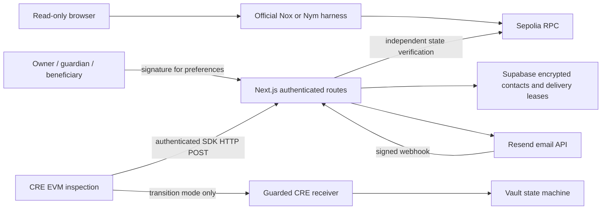
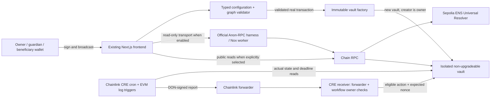
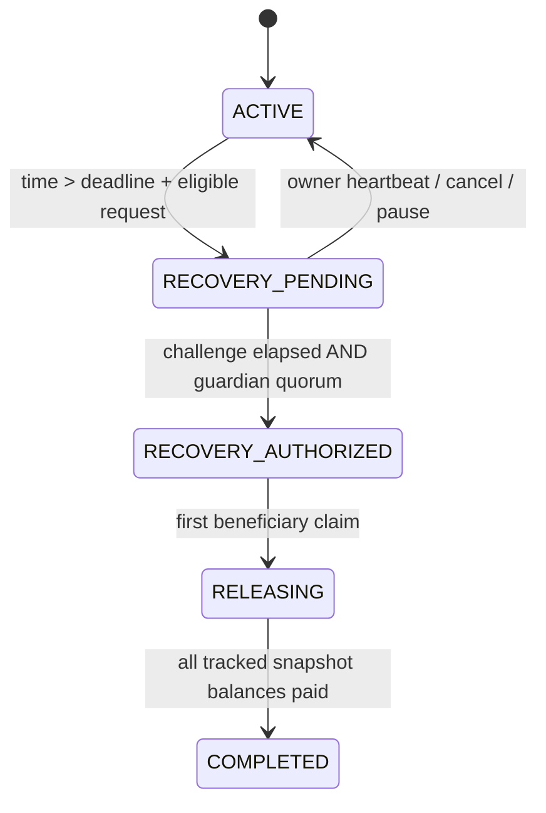

# Architecture

SilentSovereign is a testnet inheritance protocol. It does not infer legal death, hold private keys, or recover assets outside an explicitly funded vault.

The 2026-10-30 optional service extension keeps wallet-free vault review independent from private settings:



App reads default to anonymous transport. Host resources, optional notification/auth traffic, backend verification RPC and the connected wallet's provider are separate observable paths. Database/session/notification availability cannot change beneficiary entitlement or release authority. Observe-mode CRE simulation executes once and requests no report; deployed continuous execution remains an external prerequisite.



## Custody and discovery

Every factory creation deploys an independent vault with an immutable owner. There is no shared balance sheet, implementation/proxy administrator or developer-controlled recovery address. Multiple vaults per owner are supported. The UI discovers owned vaults through `getVaults`; heirs/guardians can enter a known vault address. The configured factory must recognize it before reads/writes are presented as a managed vault.

The creating wallet fixes ownership. Updating owner keys is deliberately not included; create a new vault and move active assets if needed. Direct standalone vault deployment is possible but is outside factory provenance and therefore outside the app/CRE adapter.

## Recovery state machine



An empty snapshot passes through authorized/releasing/completed immediately, with explicit events. Optional guardians with a zero quorum disable recovery. With any guardians configured, quorum must be nonzero and no greater than the unique guardian count. The owner cannot be a guardian.

`requestRecovery` and `finalizeRecovery` are public, permissionless submissions. The contract decides eligibility. `performUpkeep(action,expectedNonce)` is an idempotent automation surface that returns false for stale, duplicate or ineligible attempts. Owner and guardian actions require sender authorization; no offchain signature replay scheme is needed.

Configuration, deposits, token additions and owner withdrawals require ACTIVE. Pending recovery freezes the entire plan. The owner can cancel as long as the request is still pending, even after challenge expiry until a competing finalization wins transaction ordering. Authorization irreversibly removes owner cancellation and withdrawal powers.

## Asset accounting

Only credited deposits count. Native deposits use `msg.value`; ERC-20 deposits require exact before/after balance changes. Unsupported direct token transfers and forced ETH do not affect allocations. At authorization the accounted amount is frozen per tracked asset, checked against actual solvency, and copied to snapshot and remaining ledgers.

For asset snapshot `S`, beneficiary share `b`, and sum of preceding shares `p`:

```text
entitlement = floor(S * (p+b) / 10000) - floor(S * p / 10000)
vestedBps = min(10000, initialBps + elapsedIntervals * trancheBps)
scheduledAvailable = max(0, floor(entitlement * vestedBps / 10000) - alreadyClaimed)
emergencyAvailable = entitlement - alreadyClaimed
```

The cumulative formula assigns every wei exactly once. A tiny snapshot may give an earlier beneficiary zero wei; no dust gets trapped solely through rounding. `alreadyClaimed` is shared across scheduled and emergency claims. Emergency acceleration additionally requires a nonzero configured delay, elapsed time since authorization and fresh emergency approvals from the guardian quorum. It cannot reopen after completion.

Deposits after pending authorization are rejected through vault entrypoints. Forced native transfers and direct token transfers may still happen but remain excluded and may be inaccessible. Nonstandard/rebasing/taxed tokens are not supported.

## Editable graph and verified state

`configuration.ts` is the deterministic model and serialization boundary. A graph must preserve owner → vault → liveness → quorum → challenge, then schedule/emergency branches into every registered beneficiary. Nodes expose actual fields, not arbitrary executable conditions. Dragging only changes layout; adding/removing people changes configuration. Removing mandatory safeguards, cycles, bypass paths, orphan nodes and duplicate edges make the graph unsavable.

Each beneficiary has one account/allocation; schedules are shared across beneficiaries in this MVP. Every configured benefit takes the same safeguard path. Arbitrary per-beneficiary predicates or external oracles are intentionally rejected.

Before a save, ENS labels are resolved again and compared with reviewed pinned addresses. On receipt success the UI reloads contract configuration and reconstructs the diagram. ENS labels/diagram coordinates are not authoritative onchain data and are not secretly stored as private instructions.

Reads in one vault refresh use a common block number, with a 15-second polling interval and immediate invalidation after receipts. Activity uses chunked event reads with bounded, expandable history. Recent blocks remain reorg-sensitive. One receipt confirmation is sufficient for the testnet UX, not irreversible finality.
