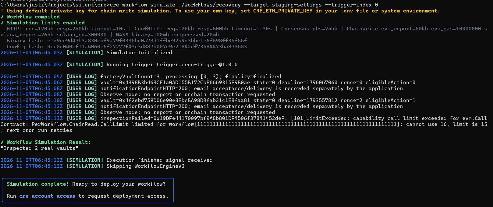

# Chainlink CRE — real vault observation and external notification orchestration

**Prize:** [Chainlink — Best workflow with CRE](https://ethglobal.com/events/mumbai/prizes/chainlink)

silent uses Chainlink Runtime Environment as the orchestration layer between real Sepolia vault state and an authenticated external notification system. The same workflow contains an optional guarded-transition path, but the captured hackathon evidence deliberately uses read-only **observe mode**.

## Why CRE is meaningful here

- A user should not have to keep the application open to inspect a liveness deadline.
- CRE reads the actual factory and each vault's state, deadline, recovery nonce and `eligibleAction`.
- CRE calls a deployed HTTPS notification endpoint using a CRE secret; the server independently checks chain state, roles and verified consent before sending email.
- In transition mode, CRE can report only action `1` (request) or `2` (finalize). The receiver and vault independently validate chain, receiver, factory provenance, nonce and eligibility.
- Manual contract calls remain available, so CRE is useful automation rather than a privileged custodian.

## Exact code map

| Capability | Direct code link | What to review |
| --- | --- | --- |
| Official TypeScript SDK | [cre/package.json](https://github.com/Rohith1510/silent/blob/main/cre/package.json#L1-L8) | Pins `@chainlink/cre-sdk` 1.23.0. |
| CRE project target | [workflow.yaml](https://github.com/Rohith1510/silent/blob/main/cre/workflows/recovery/workflow.yaml#L1-L8) | Private registry target, entrypoint, config and secret manifest. |
| Sepolia RPC target | [project.yaml](https://github.com/Rohith1510/silent/blob/main/cre/project.yaml#L1-L4) | Resolves the real Sepolia RPC from the secure environment. |
| Secret mapping | [secrets.yaml](https://github.com/Rohith1510/silent/blob/main/cre/secrets.yaml#L1-L5) | Maps the workflow secret ID to the local simulation environment without putting credentials in JSON. |
| Runtime entrypoint | [main.ts](https://github.com/Rohith1510/silent/blob/main/cre/workflows/recovery/main.ts#L1-L10) | Uses the official `Runner` and exports the compiled workflow entrypoint. |
| Configuration policy | [policy.ts](https://github.com/Rohith1510/silent/blob/main/cre/workflows/recovery/policy.ts#L17-L48) | Validates chain, batch size, HTTPS endpoint, finality and observe/transition receiver requirements. |
| Secret-authenticated HTTP capability | [workflow.ts — notification](https://github.com/Rohith1510/silent/blob/main/cre/workflows/recovery/workflow.ts#L55-L93) | Reads the CRE secret and uses the official `HTTPClient` to send only `{vault, chainId}`. |
| Real vault inspection | [workflow.ts — eligibility reads](https://github.com/Rohith1510/silent/blob/main/cre/workflows/recovery/workflow.ts#L95-L160) | Calls EVM contracts for state, deadline, nonce and eligible action; logs every observed value. |
| Guarded report/write path | [workflow.ts — report delivery](https://github.com/Rohith1510/silent/blob/main/cre/workflows/recovery/workflow.ts#L161-L188) | `runtime.report(prepareReportRequest(...))` and `EVMClient.writeReport`; observe mode exits before this path. |
| Bounded factory enumeration | [workflow.ts — batch runner](https://github.com/Rohith1510/silent/blob/main/cre/workflows/recovery/workflow.ts#L190-L235) | Reads a configured factory slice, isolates per-vault errors and retries on the next trigger. |
| Cron and EVM-log triggers | [workflow.ts — handlers](https://github.com/Rohith1510/silent/blob/main/cre/workflows/recovery/workflow.ts#L258-L302) | Official CronCapability plus optional factory/vault log triggers. |
| Current public endpoint configuration | [recovery.json](https://github.com/Rohith1510/silent/blob/main/cre/config/recovery.json#L1-L17) | Observe mode points to the deployed silent Vercel dispatch API. No secret is stored here. |
| CRE receiver | [SilentSovereignCREReceiver.sol](https://github.com/Rohith1510/silent/blob/main/contracts/SilentSovereignCREReceiver.sol#L10-L35) | Validates trusted forwarder, workflow owner, chain, receiver, factory provenance and report payload. |
| Vault eligibility and replay checks | [SilentSovereignVault.sol](https://github.com/Rohith1510/silent/blob/main/contracts/SilentSovereignVault.sol#L192-L206) | The vault computes eligibility and rejects stale nonce/action pairs independently of CRE. |
| Permissionless guarded transitions | [SilentSovereignVault.sol — request/finalize](https://github.com/Rohith1510/silent/blob/main/contracts/SilentSovereignVault.sol#L142-L180) | Missed heartbeat alone is insufficient; challenge period and guardian quorum remain mandatory. |
| Deployed notification route | [dispatch route](https://github.com/Rohith1510/silent/blob/main/frontend/app/api/notifications/dispatch/route.ts#L1-L4) | Public HTTPS route delegates to authenticated server logic. |
| Independent server verification | [notifications.ts — dispatch](https://github.com/Rohith1510/silent/blob/main/frontend/lib/server/notifications.ts#L177-L271) | Validates bearer secret, rereads chain state, selects verified roles, acquires delivery leases and calls Resend. |
| Notification policy | [notification-policy.ts](https://github.com/Rohith1510/silent/blob/main/frontend/lib/notification-policy.ts#L15-L31) | Owner reminder, pending recovery, guardian action and beneficiary availability are derived from current state. |
| SDK/policy tests | [runtime.test.ts](https://github.com/Rohith1510/silent/blob/main/cre/workflows/runtime.test.ts#L53-L170) | Tests no-write observe mode, receiver failure, triggers, notification isolation and authenticated HTTP behavior. |

## Captured official CLI simulation

[Open the full-resolution evidence](https://raw.githubusercontent.com/Rohith1510/silent/main/frontend/public/chainlink_workflow.png)



Command shown in the evidence:

```sh
cre workflow simulate ./workflows/recovery --target staging-settings --trigger-index 0
```

What the screenshot proves:

1. The official CLI compiled the workflow and initialized the simulator.
2. The real Sepolia factory returned three vaults.
3. Two real vaults were inspected with logged state, deadline, nonce and eligibility.
4. Both notification calls reached the deployed API and returned HTTP 200.
5. Observe mode explicitly requested no report or onchain transaction.
6. The CLI returned `Workflow Simulation Result: "Inspected 2 real vaults"` and `Simulation complete`.

What the screenshot also discloses:

- The third vault exceeded the simulation's per-workflow chain-read capability limit (`16` calls requested, limit `15`). This does not invalidate the two completed observations, but it means the current three-vault batch is too large for that simulation quota.
- For a clean demo, set `batchSize: 2`, or use `startIndex: 2, batchSize: 1` for the third vault. Production batches should be partitioned according to the active CRE quota.
- HTTP 200 means the application processed the dispatch request; delivery acceptance and webhook status are recorded separately by the notification backend.
- This is a successful local CRE CLI simulation, not a deployed continuously running DON workflow.

## Prize-requirement mapping

| ETHGlobal requirement | silent evidence |
| --- | --- |
| Build, simulate or deploy a CRE workflow | Official TypeScript SDK workflow and captured CLI simulation. Deployment is not claimed. |
| Integrate a blockchain with an external system | Real Sepolia factory/vault reads are connected to the deployed Vercel notification API, Supabase consent/delivery state and Resend email. |
| Demonstrate successful CLI simulation or deployment | Screenshot shows workflow compilation, real reads, HTTP 200 dispatches and a completed simulation result. |
| Meaningfully used by the project | Deadline/recovery monitoring is a core inheritance-safety task; the app does not need to remain open. |

## Security and authority boundary

- CRE never receives beneficiary email addresses; it sends only vault address and chain ID.
- The backend independently rereads chain state and derives recipients from verified, encrypted subscriptions.
- Observe mode cannot write onchain.
- Transition mode is restricted by the receiver and then by the vault's current state, nonce, challenge and guardian quorum.
- CRE does not sign guardian approvals, withdraw assets, claim inheritance or change vault configuration.
- A notification failure cannot authorize or block a recovery transition.

## Two-minute judge demo

1. Show `recovery.json`: Sepolia, real factory, observe mode and deployed HTTPS endpoint.
2. Run the command above.
3. Point to the real vault addresses, deadlines, nonces and eligible actions.
4. Point to `notificationEndpointHTTP=200` and the matching Email Alerts/Resend delivery record.
5. Open the workflow code at `inspectVault`, then the receiver and vault eligibility code.
6. Say explicitly: “Simulation is live evidence; continuous DON deployment is pending Chainlink deployment access.”

Official references: [CRE overview](https://docs.chain.link/cre/overview), [TypeScript EVM client](https://docs.chain.link/cre/reference/sdk/evm-client-ts), [project configuration](https://docs.chain.link/cre/reference/project-configuration-ts), and [workflow simulation](https://docs.chain.link/cre/guides/operations/simulating-workflows).

